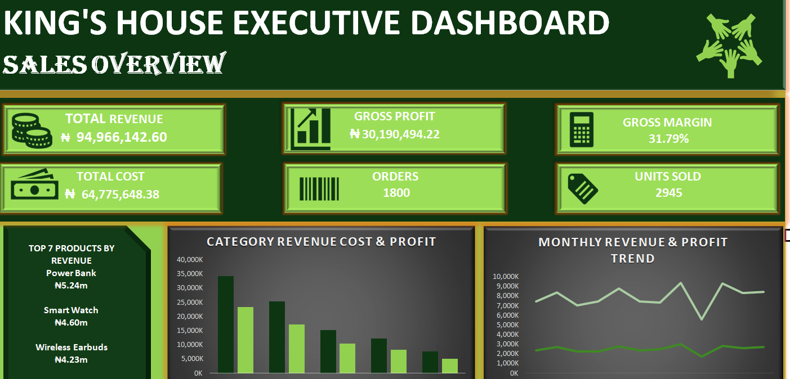
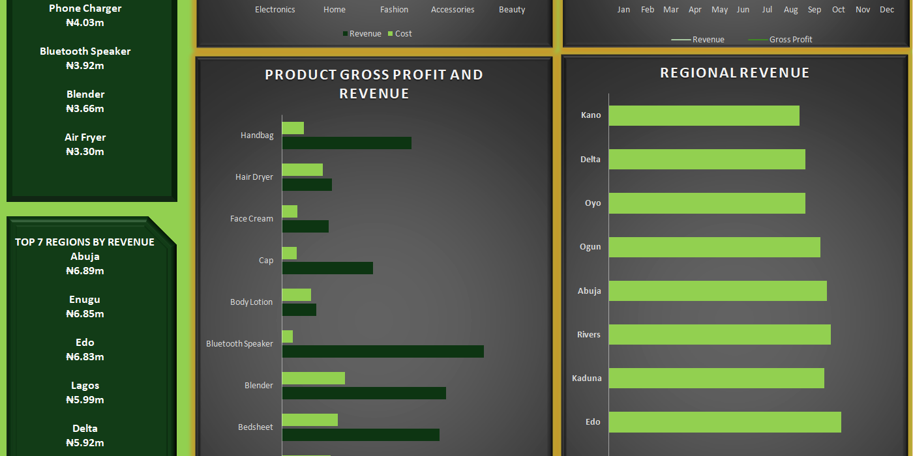
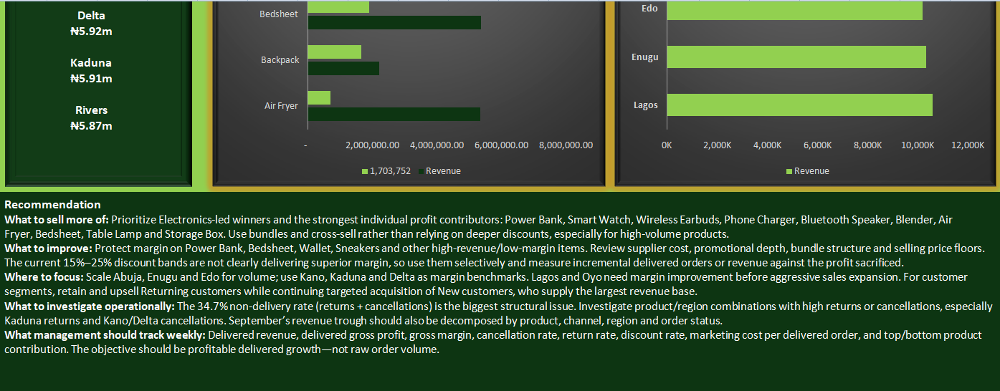

# Kings House: Sales & Profitability Performance Review

> **Note:** This project uses **simulated (synthetic) data** created by BoyCode Africa for educational and portfolio purposes. It does not represent a real company.

Group capstone project by **Kings House**, BoyCode Africa Cohort 5.0 (Microsoft Excel).

## Dashboard

## Business Problem
Management wanted to understand what drives revenue and profit, and where the business should focus its sales effort.

## Dataset
A fictional Nigerian e-commerce company: 1,812 raw records covering orders, customers, regions, products, categories, revenue, cost, profit, marketing channel, delivery, payment, status and ratings.

## Data Preparation
- 12 duplicate records removed, leaving 1,800 orders
- 10 missing regions and 7 missing channels labelled "Unknown"
- 314 missing ratings left blank
- The full log is in the Data Quality sheet of the workbook, and the original raw file is kept in this repository

## Analysis
Built in Microsoft Excel: a cleaned dataset, monthly trend, category, region, product and customer segment analysis, discount analysis, and an executive dashboard with KPI cards and charts.

## Key Findings
1. Total revenue of **₦94.97m**, gross profit of **₦30.19m**, and a gross margin of **31.79%**, from **1,800 orders** and **2,945 units**
2. Electronics is the leading category by revenue
3. Top products by revenue: Power Bank, Smart Watch and Wireless Earbuds
4. **34.7%** of orders were not delivered (returns plus cancellations), and **20.6%** of deliveries were late
5. Discounts in the 15% to 25% bands do not clearly deliver better margin, and September shows a revenue dip

## Recommendations
- **Sell more of:** Electronics-led winners and the strongest profit contributors, using bundles and cross-selling rather than deeper discounts
- **Review:** margins on high-revenue, low-margin products, including supplier cost, promotions and price floors
- **Investigate:** the high rate of returns and cancellations, and the September revenue dip
- **Track weekly:** delivered revenue, delivered gross profit, margin, cancellation and return rates, and discount rate

## Limitations
The data is simulated, covers a single year, and shows patterns only. It cannot prove cause and effect.

## Files in this Repository
- `Kings-House-Executive-Sales-Dashboard.xlsx`: cleaned workbook with analysis and dashboard
- `BoyCodeAfrica_Ecommerce_Dataset.csv`: raw dataset
- `Dashboard-1.png`, `Dashboard-2.png`, `Dashboard-3.png`: dashboard screenshots

## Tools
Microsoft Excel
